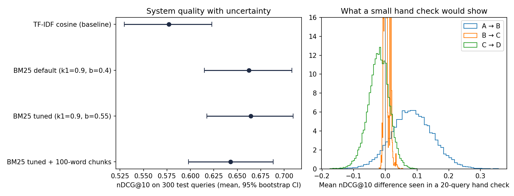

# Did that retrieval change really help?

In my work on retrieval-augmented generation, a common question is whether a change
(a new scoring function, re-tuned parameters, splitting documents into chunks) actually
made retrieval better. The usual way to answer is to try a handful of questions and read the results.
This project asks the same question statistically, on a public benchmark with relevance labels.

**Data:** [BEIR SciFact](https://github.com/beir-cellar/beir): 5,183 scientific abstracts,
809 train and 300 test queries with expert relevance judgements.
**Rule:** parameters are tuned on the train queries only; every number below is on the 300 held-out test queries.

## Systems compared

| | System | What changes |
|---|---|---|
| A | TF-IDF cosine | baseline |
| B | BM25, default parameters (k1 = 0.9, b = 0.4) | scoring function |
| C | BM25, tuned on train by grid search (k1 = 0.9, b = 0.55) | parameters |
| D | C + documents split into 100-word passages (stride 50), doc score = best passage | chunking |

## Results (300 test queries)

| System | nDCG@10 (95% CI) | Recall@10 (95% CI) | MRR@10 (95% CI) |
|---|---|---|---|
| A  TF-IDF cosine | 0.577 [0.529, 0.624] | 0.720 [0.669, 0.769] | 0.541 [0.491, 0.590] |
| B  BM25 default | 0.662 [0.614, 0.708] | 0.773 [0.726, 0.818] | 0.632 [0.584, 0.681] |
| C  BM25 tuned | 0.664 [0.618, 0.710] | 0.776 [0.730, 0.822] | 0.634 [0.585, 0.682] |
| D  BM25 tuned + chunks | 0.643 [0.596, 0.689] | 0.770 [0.723, 0.816] | 0.609 [0.560, 0.656] |

Each change, tested on paired per-query nDCG@10:

| Change | Mean diff [95% CI] | Queries better / worse / tied | p (Holm) | 20-query check picks the opposite winner |
|---|---|---|---|---|
| A → B  scoring function | +0.085 [+0.052, +0.119] | 88 / 32 / 180 | 0.0004 | 9% |
| B → C  parameter tuning | +0.002 [−0.001, +0.006] | 13 / 8 / 279 | 0.35 | 30% |
| C → D  chunking | −0.021 [−0.038, −0.005] | 29 / 46 / 225 | 0.031 | 26% |
| A → D  baseline vs final | +0.066 [+0.032, +0.100] | 81 / 44 / 175 | 0.0004 | 16% |



## What this shows

1. **Switching to BM25 is a real improvement.** +0.085 nDCG@10, the confidence interval is far from zero,
   and it holds after correcting for four comparisons. (Default BM25 reaches 0.662, close to the
   0.665 BEIR reports for SciFact, which is a sanity check on the implementation.)
2. **Tuning BM25 changed almost nothing.** 279 of 300 queries are unaffected and the interval
   contains zero. The train split preferred b = 0.55, but on the test split this is noise.
3. **Chunking made retrieval worse here.** The intervals of C and D overlap heavily, which suggests no
   difference, but the *paired* test shows chunking loses on 46 queries and wins on 29 (p = 0.031).
   SciFact abstracts are short, so splitting them mostly removes context. Comparing overlapping
   intervals is the wrong test for paired data.
4. **Small hand checks mislead.** If I had judged each change on 20 random queries, I would have
   picked the opposite winner about a quarter of the time for the chunking change, and 30% of the time for
   the tuning change, where there is no real difference to find.

## Methods

- **Metrics:** nDCG@10, Recall@10 and MRR@10 per query (binary relevance).
- **Confidence intervals:** percentile bootstrap over queries, 10,000 resamples.
- **Significance:** two-sided paired randomization (sign-flip) test on per-query differences,
  10,000 permutations, Holm correction across the four comparisons.
- **Small-sample check:** draw 20 test queries with replacement 5,000 times and count how often
  the sign of the mean difference is the opposite of the full-sample result.
- BM25 and TF-IDF are implemented directly with sparse matrices (NumPy and SciPy). No retrieval
  library is used, so every scoring step is visible in `retrieval_eval.py`.

## Limitations

- One dataset and lexical retrievers only. Dense embeddings and an LLM answer-quality metric
  would make this closer to a real RAG system.
- The query bootstrap treats the 300 test queries as a sample from the population of questions users ask.
  That holds only if those queries are representative.
- The grid search covers 25 settings; a finer grid would not change conclusion 2.

## Run

```bash
mkdir -p data && cd data
curl -LO https://public.ukp.informatik.tu-darmstadt.de/thakur/BEIR/datasets/scifact.zip && unzip scifact.zip && cd ..
pip install numpy scipy scikit-learn matplotlib
python retrieval_eval.py      # ~25 s on a laptop; writes results/
```
