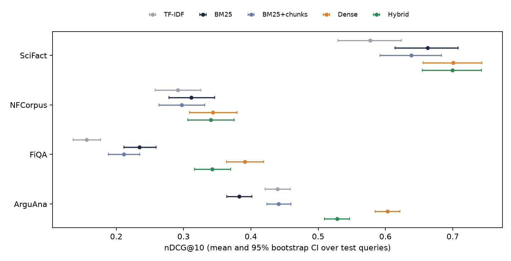
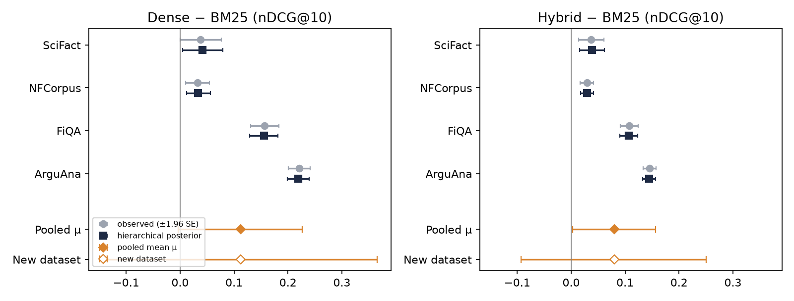
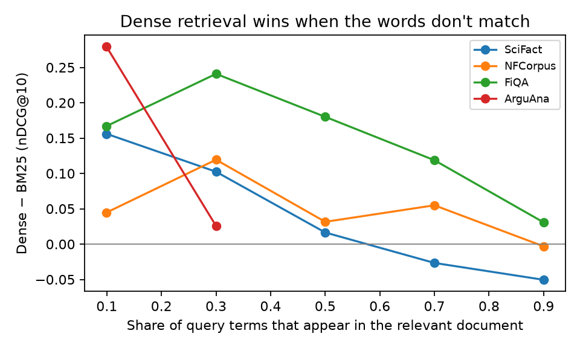
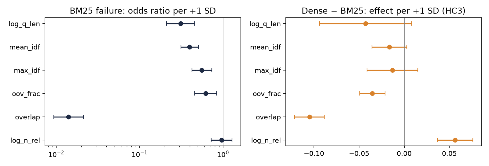
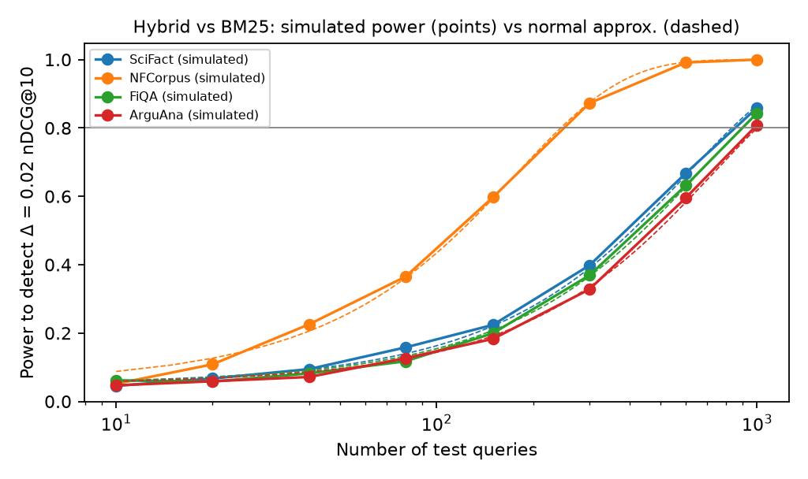
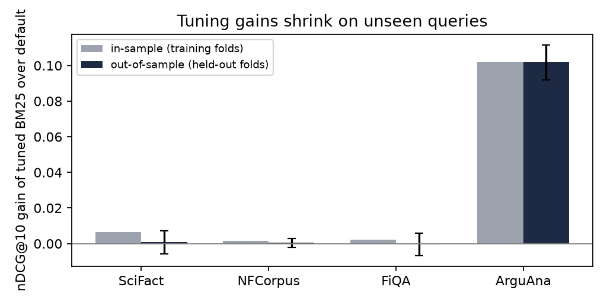

# Did that retrieval change really help?

**A statistical evaluation of retrieval for RAG systems across four BEIR benchmarks**

In retrieval-augmented generation, a change to retrieval is usually judged by trying a handful of
questions and reading the answers. This project asks the statistical questions behind that habit:

1. **Is a difference real?** Paired tests and bootstrap intervals on per-query scores, corrected for multiple comparisons.
2. **Does it generalise?** A mixed model and a Bayesian hierarchical model across datasets, including a prediction for an unseen dataset.
3. **When does retrieval fail, and why?** A logistic GLM, linear models compared by AIC/BIC, and a Lasso with interactions.
4. **How much evidence is enough?** Analytic and simulated power analysis.
5. **Does tuning help, or just fit noise?** Nested cross-validation of BM25 parameters.

Everything is reproducible with one command (`make`). BM25, TF-IDF, chunking, rank fusion and every
statistical procedure, including the Bayesian model, are implemented in this repository with NumPy and SciPy, and covered by unit tests.

## Data and systems

| Dataset | Domain | Documents | Test queries |
|---|---|---|---|
| SciFact | scientific claims | 5,183 | 300 |
| NFCorpus | nutrition and medicine (graded labels) | 3,633 | 323 |
| FiQA | financial Q&A | 57,638 | 648 |
| ArguAna | counter-argument retrieval | 8,674 | 1,406 |

| System | Description |
|---|---|
| TF-IDF | cosine similarity on TF-IDF vectors |
| BM25 | Okapi BM25, k1 = 0.9, b = 0.4 (implemented on sparse matrices) |
| BM25+chunks | BM25 over 100-word passages (stride 50); a document scores as its best passage |
| Dense | `BAAI/bge-small-en-v1.5` sentence embeddings, cosine similarity |
| Hybrid | reciprocal rank fusion (k = 60) of BM25 and Dense |

Sanity check: Dense reaches 0.701 / 0.344 / 0.391 / 0.603 nDCG@10, close to the published
bge-small scores (0.713 / 0.343 / 0.403 / 0.596). BM25 on SciFact reaches 0.662, against 0.665 in BEIR.

## Key findings

**1. Dense retrieval beats BM25 on all four datasets, but the size of the gain depends heavily on the domain.**
The gain is about +0.03 on SciFact and NFCorpus, and +0.16 and +0.22 on FiQA and ArguAna. On SciFact the 95% interval
just touches zero (p = 0.049 after Holm correction across 16 tests). That is borderline evidence, even though
300 queries sounds like plenty.

**2. Adding BM25 to dense retrieval (hybrid) never helped.** Hybrid ties Dense on SciFact and NFCorpus, and is
significantly *worse* on FiQA (−0.049) and ArguAna (−0.075), where BM25 is weak and drags the fusion down.
"Hybrid search is always safer" does not hold here.

**3. Pooled across datasets, the evidence is strong, but the prediction for a new dataset is uncertain.**
The Bayesian hierarchical model gives P(Dense better than BM25) = 0.97 on average. But the between-dataset spread
(τ ≈ 0.09) is about as large as the effect itself, so for a *new* dataset the predicted gain is
+0.11 with a 95% interval of [−0.14, +0.37], P(gain > 0) = 0.85. With only four datasets, the result
should not be generalised further than that.

**4. Dense retrieval wins where the words don't match.** In a logistic GLM (n = 2,677 queries,
dataset fixed effects), lexical overlap between query and relevant document is by far the strongest
predictor of BM25 failure (odds ratio 0.01 per SD). In linear models of the Dense − BM25 gap, overlap is again
the main driver (−0.105 per SD, HC3 robust CI [−0.121, −0.088]). BIC selects a model where this slope differs by dataset.
*Caveat:* overlap is measured against the labelled relevant document, so it explains failures after the
fact but cannot be computed at query time.

**5. Most per-query variation is unexplained.** The best model explains about 9% of the Dense − BM25 variance
out of sample (10-fold CV R², with Lasso and unpenalised OLS performing the same). Query-level outcomes
are mostly idiosyncratic, which is exactly why averages over small samples are unstable.

**6. Small checks mislead, and adequate test sets are large.** On SciFact, a 20-query check would declare
BM25 better than Dense 31% of the time. To detect a 0.02 nDCG@10 improvement with 80% power you need
about 250 to 3,000 queries depending on the dataset. Comparisons against Hybrid need far fewer, because the paired differences
have roughly a third of the variance.

**7. Tuning BM25 is mostly optimism, with one exception.** Nested CV (5 folds × 20 repetitions) shows that on three
datasets the in-sample gain from tuning (+0.002 to +0.007) mostly disappears on held-out queries
(the 95% interval contains zero). On ArguAna, whose queries are full paragraphs, tuning gives a real +0.10.
Default parameters are a poor fit for that kind of query, and nested CV distinguishes the two cases. The chosen setting
(k1 = 2.0, b = 0.9) lies on the edge of the grid, so the optimum may be further out.

**8. Chunking is not a free win.** Splitting documents into passages hurts on SciFact, NFCorpus and FiQA, where
documents are short, and helps on ArguAna. Pooled, the effect is zero.








Full tables: [`results/tables.md`](results/tables.md) · all numbers: [`results/summary.json`](results/summary.json)

## Methods

| Question | Method |
|---|---|
| Uncertainty of a mean | percentile bootstrap over queries, 10,000 resamples |
| Is a difference real? | two-sided paired randomization (sign-flip) test, 10,000 permutations; Holm correction per family. The smallest attainable Holm-adjusted p is 16/10,001 ≈ 0.0016. |
| Small-sample risk | 5,000 random draws of 20 queries; how often the sign of the mean difference flips |
| Pooling across datasets | (i) linear mixed model `d ~ 1 + (1 | dataset)` (REML, statsmodels); (ii) Bayesian normal hierarchical model: y_j ~ N(θ_j, se_j²), θ_j ~ N(μ, τ²), flat prior on μ, half-Cauchy(0, 0.05) prior on τ. The posterior of τ is computed exactly on a grid, then μ and θ_j are drawn from their conditional normals (Gelman et al., *BDA3*, ch. 5) |
| When does BM25 fail? | binomial GLM (logit link) of "no relevant document in top 10" on standardized query features, dataset fixed effects |
| What drives the Dense − BM25 gap? | nested OLS models compared by AIC/BIC; HC3 robust standard errors; Lasso over 45 features and pairwise interactions with α chosen by 10-fold CV; out-of-sample R² |
| How many queries are needed? | n = ((z₁₋α/₂ + z₁₋β) σ_d / Δ)², checked against simulated power from resampled paired differences |
| Is tuning real? | nested CV: grid search over 25 (k1, b) settings on training folds, evaluated on held-out folds, 5 folds × 20 repetitions |

Query features: query length (log), mean and maximum IDF of query terms, share of query terms not in the
corpus vocabulary, lexical overlap with the relevant document, and number of relevant documents (log).

## Limitations

- Four datasets is a small sample for estimating between-dataset variance; the mixed model warns about a
  boundary fit, and τ's posterior depends on its prior. That is why the Bayesian prediction for a new dataset is so wide.
- Scores are retrieval metrics against human labels, not the quality of a generated answer.
- The randomization test treats queries as exchangeable. Queries from the same topic (for example ArguAna debates)
  are probably correlated, so the p-values are somewhat optimistic.
- The overlap feature uses relevance labels (see finding 4).

## Reproduce

```bash
pip install -r requirements.txt
make            # downloads the 4 datasets, runs all systems (~15 min on an M-series laptop), runs the analysis
make test       # 14 unit tests: metrics, BM25, chunking, RRF, Holm, randomization test, bootstrap, power, hierarchical model
```

Layout: `reteval/run.py` (stage 1: retrieval, per-query results) · `reteval/analysis.py` (stage 2: statistics,
models, figures) · `reteval/stats.py` (inference tools) · `reteval/retrievers.py` · `reteval/metrics.py` ·
`legacy_v1_scifact.py` (the first, single-dataset version of this study).

*Developed with the help of an AI coding assistant.*
